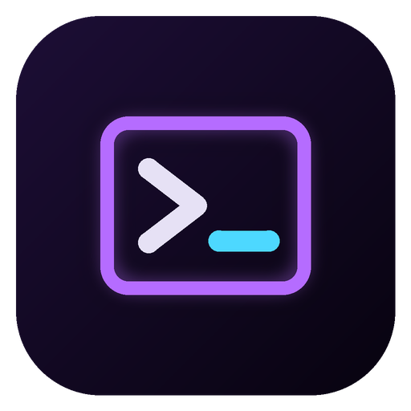

<div align="center">

[English](README_en.md) · [简体中文](README_zh.md) · [繁體中文](README_zh-TW.md) · **日本語** · [한국어](README_ko.md) · [Türkçe](README_tr.md) · [Русский](README_ru.md) · [Tiếng Việt](README_vi.md) · [ไทย](README_th.md) · [Deutsch](README_de.md) · [Español](README_es.md) · [Français](../../README.md) · [Українська](README_uk.md) · [Polski](README_pl.md) · [Português (Brasil)](README_pt-BR.md) · [العربية](README_ar.md) · [فارسی](README_fa.md) · [Bahasa Indonesia](README_id.md) · [Italiano](README_it.md)
· [Ελληνικά](README_el.md) · [മലയാളം](README_ml.md) · [Roman Urdu](README_ur-Latn.md) · [Română](README_ro.md)

</div>

<p align="center"></p>

# Cyber

**Android・Windows・Linux** 向けの **SSH** ターミナル兼**ローカルシェル**です。Termux の流れをくみつつ、インターフェースを細部まで調整できます：テーマ、16 色それぞれの色、フォント、カーソル、キーバー、クイックコマンド…… 3 つのバージョンは同じインターフェースと同じバックアップ形式を共有しているので、設定とサーバーはファイル 1 つでスマホから PC へ移せます。

Galaxy Z Fold 向けに設計：折りたたんだ状態では接続一覧がドロワーで開き、開いた状態（または PC）では左側に常に表示されます。

## ダウンロード

| OS | ファイル | |
|---|---|---|
| Android | **[Cyber.apk](https://github.com/apk-fold/Cyber/releases/latest/download/Cyber.apk)** | Android 8 以降 |
| Windows | **[Cyber-Setup.exe](https://github.com/apk-fold/Cyber/releases/latest/download/Cyber-Setup.exe)** | インストーラー |
| Windows | [Cyber-Portable.exe](https://github.com/apk-fold/Cyber/releases/latest/download/Cyber-Portable.exe) | インストール不要 |
| Linux | **[Cyber.AppImage](https://github.com/apk-fold/Cyber/releases/latest/download/Cyber.AppImage)** | `chmod +x Cyber.AppImage` のあと起動 |
| Linux | [Cyber-linux.tar.gz](https://github.com/apk-fold/Cyber/releases/latest/download/Cyber-linux.tar.gz) | 展開して `./cyber` を起動 |

すべてのバージョンは [*Releases*](https://github.com/apk-fold/Cyber/releases) タブにあり、SHA-256 ハッシュも掲載しています。コードが変更されるたびに GitHub Actions で自動的にビルドされます。

- **Android**：`Cyber.apk` を開き、この提供元からのインストールを許可して*インストール*をタップします。アップデートは設定を失わずに上書きインストールできます（同じ署名鍵）。
- **Windows**：ファイルは署名されていないため、SmartScreen で*詳細情報 → 実行*を選ぶ必要があります。

## Cyber でできること

### ターミナル
- [xterm.js](https://xtermjs.org) エンジン：256 色と 24 ビットカラー、Unicode、クリック可能なリンク、GPU 描画。
- 無制限の**タブ**（名前の変更、複製、再接続、全テキストのコピー）、スクロールバックの**検索**、スクロールバックは最大 100,000 行まで設定可能。
- 右クリック、選択時、または Ctrl+C / Ctrl+V でのコピー＆ペースト（選択式）。

### ローカルシェル
- **Android**：システムシェル（`/system/bin/sh`）を**本物の疑似端末**（ネイティブモジュール）で実行。**起動スクリプト**（プロンプト、エイリアス、変数）は設定で編集できます。
- **Windows**：デフォルトは PowerShell。`cmd.exe`、`pwsh`、`wsl.exe` なども使えます。
- **Linux**：あなたのシェル（`$SHELL`）。
- コマンド、引数、開始フォルダーを設定可能。

### SSH
- 保存された**プロファイル**（名前、ホスト、ポート、ユーザー、色、サーバーごとのテーマ）と、`ユーザー@ホスト:ポート` による**クイック接続**。
- パスワード（毎回入力または記憶）または **SSH 鍵**：アプリ内で **Ed25519** 鍵を生成（公開鍵はワンタップでコピー）、OpenSSH・PEM・PuTTY 形式の鍵をインポート、パスフレーズ対応。
- 初回接続時にサーバーの**フィンガープリントを検証**し、変わった場合は警告します。
- キープアライブ、タイムアウトの調整、**起動時コマンド**（例：`tmux attach || tmux`）。
- Android では、アプリがバックグラウンドに移っても通知でセッションを維持します。

### カスタマイズ
- **12 種類のテーマ**：Cyber ネオン、ミッドナイト、東京ナイト、Dracula、Nord、One Dark、Gruvbox、Monokai、Solarized、マトリックス、レトロアンバー、ペーパー（ライト）。
- **カラーエディター**：背景、文字、カーソル、選択範囲、16 色の ANSI カラーをライブプレビュー付きで編集。テーマのエクスポートとインポート。
- インターフェースのアクセントカラー、余白、タブを上または下に配置。
- フォント：JetBrains Mono と Fira Code を内蔵、またはインストール済みの任意のフォント。サイズ、行の高さ、字間、ウェイト、最小コントラスト。
- ブロック・下線・バーのカーソル、点滅の有無。ベルはフラッシュ、サウンド、バイブレーションから選択。

### タッチキーボード
- Termux 風の**キーバー**（ESC、TAB、CTRL、ALT、矢印、HOME、END、PG↑/PG↓、F1–F12……）。配置は自分で記述でき、1〜4 段に対応。ほかのキーはその文字列を送信します（`|`、`~`、`:wq`……）。
- 「スティッキー」な CTRL と ALT：1 回タップ = 1 回だけ、素早く 2 回タップ = ロック。
- ターミナルで**ピンチズーム**、キー押下時のバイブレーション（オフにできます）。

### クイックコマンド
⚡ ボタンで、保存したコマンドをアクティブなタブに送信します（Enter の有無を選択可能）。

### バックアップ
すべての設定、テーマ、接続、信頼済みサーバーを JSON でエクスポート（パスワードと秘密鍵は指定したときのみ）し、別のデバイスで復元できます。

## ショートカット（PC）

| ショートカット | 操作 |
|---|---|
| Ctrl+Shift+T | 新しいローカルシェル |
| Ctrl+Shift+N | 新しい SSH 接続 |
| Ctrl+Shift+W | タブを閉じる |
| Ctrl+Tab / Ctrl+Shift+Tab | 次 / 前のタブ |
| Alt+1 … Alt+9 | n 番目のタブへ移動 |
| Ctrl+Shift+C / Ctrl+Shift+V | コピー / 貼り付け |
| Ctrl+Shift+F | 検索 |
| Ctrl + / Ctrl − / Ctrl 0 | 文字サイズ |
| Ctrl+, | 設定 |

## 自分でビルドする

[Node.js](https://nodejs.org) 22 が必要です。

```sh
npm install
npm start              # PC 版を開発モードで起動
npm run dist:win       # Windows インストーラー + ポータブル版 → release/
npm run dist:linux     # AppImage + tar.gz → release/（Linux 上で実行）
```

APK の場合（JDK 21 と Android SDK、または Android Studio）：

```sh
npm install
npm run build:web      # インターフェースを android/app/src/main/assets/www にコピー
cd android
gradlew assembleRelease   # → android/app/build/outputs/apk/release/app-release.apk
```

ローカルシェルのネイティブモジュール（`android/app/src/main/cpp`）は NDK でコンパイルされます。NDK は必要に応じて Android Studio がインストールします。

## APK の署名

すべてのバージョンは**同じ鍵**（`signing/cyber.jks`）で署名されているため、アップデートを上書きインストールできます。この鍵はリポジトリで公開されているので、Cyber はこのリポジトリからのみインストールしてください。独自の非公開鍵を使う場合は、*Settings › Secrets › Actions* にシークレット `CYBER_KEYSTORE_B64`（base64 化した .jks ファイル）、`CYBER_KEYSTORE_PASSWORD`、`CYBER_KEY_ALIAS`、`CYBER_KEY_PASSWORD` を追加します（鍵を変えると旧バージョンのアンインストールが必要になるため、先にバックアップをエクスポートしてください）。

## 知っておきたいこと

- 設定、接続、鍵、信頼済みサーバーは**デバイス上にのみ**保存され、追加の暗号化はされません。共用デバイスではパスワードを記憶させないでください。
- Android のローカルシェルで使えるのはシステムのコマンド（`ls`、`cat`、`ping`、`top`……）で、Termux のようなパッケージマネージャー付きの完全な Linux ではありません。それが必要な場合は、SSH でサーバー（または `sshd` を動かした Termux 自体）に接続してください。

## リポジトリ構成

| フォルダー | 内容 |
|---|---|
| `web/` | 共通インターフェース（HTML、CSS、JavaScript） |
| `desktop/` | Windows・Linux 版（Electron、ssh2、node-pty） |
| `android/` | Android 版（WebView、JSch、C で書かれた疑似端末） |
| `scripts/` | インターフェースの準備とビルド補助 |
| `tests/` | 実際の SSH、ローカルシェル、インターフェースのテスト（ビルドごとに実行） |
| `signing/` | APK 署名鍵 |
